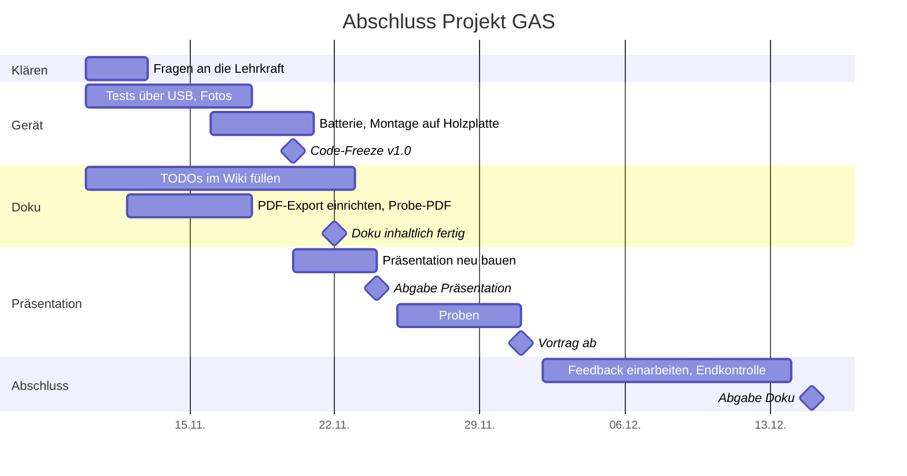

# Abschlussplan — Projekt GAS

Stand: 10.11.2026. Plan für alles, was bis zur Abgabe noch passieren muss.
Grundlage sind die Vorgaben der Lehrkraft (zehn Kapitel, Präsentation, Regeln
zum KI-Einsatz) und der aktuelle Stand im Repository.

Hinter jeder Aufgabe steht, wer sie erledigen kann:

- **(Team)** braucht Hände am Gerät, eure Meinung oder Wissen, das nur ihr habt
- **(Claude)** kann in einer Claude-Code-Sitzung erledigt werden, sobald ihr die
  Angaben liefert
- **(Lehrkraft)** muss gefragt werden

## Termine

| Datum | Was | Bedeutung für uns |
|---|---|---|
| **Di 24.11.2026** | Abgabe Präsentation | Präsentation als **HTML-Datei** fertig und abgegeben |
| **Di 01.12.2026** | Start der Präsentationen | ab hier kann unsere Gruppe dran sein, Gerät muss vorführbereit sein |
| **Di 15.12.2026** | Abgabe Projektdokumentation | **das ganze Repository** abgeben, die Doku liegt darin als **PDF** |

## Abgabeform (geklärt am 10.11.2026)

- **Abgegeben wird das komplette Repository, als Link.** Das Repository ist
  öffentlich, die Lehrkraft braucht keinen Zugang. Der Sourcecode ist damit als
  eigene Dateien dabei (`Code/`), wie die Vorgabe es verlangt.
- **Das Arbeitsprotokoll `MDs/entwicklungsverlauf.md`** (Prompts im Wortlaut)
  darf im Repository bleiben, kommt aber **nicht ins PDF**.
- **Die Dokumentation muss ein PDF sein.** Das PDF wird aus den Wiki-Seiten in
  `wiki/` erzeugt und liegt im Repository als
  `Projektdokumentation_GAS.pdf`. Das Wiki bleibt die Quelle, geändert wird
  nur dort, danach wird das PDF neu erzeugt.
- **Präsentiert wird auf Jans Notebook.** Animationen und 3D im Browser laufen
  dort flüssig (ausprobiert), die neue Präsentation darf also Motion Graphics
  nutzen.
- **Termin:** Annahme ist der erste Präsentationstag, **Di 01.12.2026**.
- **Dauer:** insgesamt **mindestens 15 Minuten**, jeder hat einen erkennbar
  eigenen Teil.
- **Zitierweise:** wie an der Hochschule üblich, nummeriert nach **IEEE**.
  Im Text steht die Nummer in eckigen Klammern, z. B. „laut Datenblatt [4]“,
  im Quellenverzeichnis die vollständige Angabe.
- **Die Präsentation darf HTML sein.** Sie liegt im Repository unter
  `praesentation/` und wird als eine einzelne, offline lauffähige HTML-Datei
  abgegeben.

Folgen für den Plan:

- Weil das ganze Repository abgegeben wird, gehört alles darin zur Abgabe.
  Veraltete oder verwirrende Dateien müssen aufgeräumt werden (Phase 2).
- Das PDF braucht ein Export-Skript. Das wird **früh** gebaut (Phase 3), damit
  Probleme beim Umwandeln nicht erst kurz vor dem 15.12. auffallen.

## Roter Faden

Die Präsentation muss **vor** der Dokumentation abgegeben werden. Damit beides
zusammenpasst, gilt diese Reihenfolge:

```text
Gerät fertig + getestet  →  Doku inhaltlich fertig  →  Präsentation aus der Doku bauen
     (bis 20.11.)               (bis 22.11.)              (20.–24.11.)
                                                                │
          Doku abgeben  ←  Feedback aus der Präsentation einarbeiten  ←  vortragen
           (15.12.)                  (bis 13.12.)                        (ab 01.12.)
```

- Die Präsentation erzählt dieselbe Geschichte wie die Doku, in derselben
  Reihenfolge (Kapitel 2 → 9). Wer die Präsentation gesehen hat, findet jede
  Folie in der Doku wieder.
- Zahlen, Fotos und Begriffe stehen zuerst in der Doku und werden von dort in
  die Präsentation übernommen, nicht umgekehrt.
- Die Präsentation wird **komplett neu** gebaut, als letzter großer Schritt.

## Übersicht



Puffer: zwischen „Doku inhaltlich fertig“ (22.11.) und der Doku-Abgabe
(15.12.) liegen fast vier Wochen. Wenn etwas länger dauert, verschiebt sich die
Doku, **nicht** die Präsentation.

---

## Phase 0 · Sofort klären (bis Fr 13.11.)

Die Fragen zur Abgabeform sind beantwortet (siehe oben). Offen ist noch:

- [x] **(Lehrkraft)** Form der Doku → **PDF**
- [x] **(Lehrkraft)** Form des Sourcecodes → **ganzes Repository**
- [x] **(Lehrkraft)** Format der Präsentation → **egal, HTML ist in Ordnung**
- [x] **(Lehrkraft)** Wie wird das Repository geschickt? → **als Link**, das
      Repository ist öffentlich
- [x] **(Lehrkraft)** Arbeitsprotokoll `MDs/entwicklungsverlauf.md` im
      Repository? → **darf bleiben, aber nicht ins PDF**
- [x] **(Team)** Präsentationsrechner → **Jans Notebook**, Animationen und 3D
      im Browser laufen dort gut
- [x] **(Team)** Termin → Annahme **Di 01.12.2026**
- [x] **(Team)** Dauer → insgesamt **mindestens 15 Minuten**
- [x] **(Team)** Zitierformat → **IEEE** (nummeriert, wie an der Hochschule)
- [x] **(Team)** Arbeitsweise: Alles wird auf dem Branch
      `claude/trusting-knuth-awmzj8` erledigt. Wenn alles fertig ist, kommt es
      mit **einem Pull Request** nach `main` (spätestens in Phase 6). Bis dahin
      ist das GitHub-Wiki noch auf dem alten Stand, weil es nur bei Änderungen
      an `main` aktualisiert wird.

## Phase 1 · Gerät fertig bauen und testen (bis Fr 20.11.)

Ohne fertiges Gerät keine Fotos, keine Messwerte und keine Demo. Deshalb zuerst.

**Fotos** kommen in den Ordner [`Fotos/`](../Fotos/). Dort steht die Fotoliste
mit Dateinamen und wie man hochlädt.

- [ ] **(Team)** **Pflichtfoto** für Kapitel 5: Bedienteil **offen**, von oben,
      alle Kabel und das Mini-Breadboard sichtbar → `Fotos/aufbau_offen.jpg`.
      Dafür das Gehäuse einmal aufschrauben. Falls noch ein altes Foto vom
      ersten Aufbau auf dem großen Breadboard existiert, zusätzlich
      `Fotos/aufbau_breadboard.jpg`.
- [ ] **(Team)** Sensorteil offen, die verstärkten Schraubpunkte sichtbar →
      `Fotos/sensorteil_offen.jpg`
- [ ] **(Claude)** Fotos verkleinern, Metadaten (GPS) entfernen und ins Wiki
      einbauen

**Einbau:**

- [x] **(Team)** Bedienteil und Sensorteil verkabelt und verschraubt
      (10.11.2026), noch lose, nicht auf einer Platte
- [x] **(Team)** Notiert, was beim Druck nicht gepasst hat: Der Drucker ist
      nicht der beste, am Deckel des Sensorgehäuses mussten die Schraubpunkte
      für den Bewegungsmelder verstärkt werden, damit sie nicht abbrechen
      (steht in Kapitel 8)
- [ ] **(Team)** Prüfen, ob die verstärkte Version wirklich im Repository ist:
      In `Gehaeuse/gehaeuse.scad` und `stl/sensor_front.stl` sind die
      Schraubpunkte noch die ursprünglichen (4 mm Durchmesser, Stand
      23.09.2026). Wenn die Änderung woanders gemacht wurde (Slicer,
      Tinkercad …), Claude sagen, was geändert wurde, damit Modell, STL und
      Bilder zum gedruckten Teil passen.
- [ ] **(Team)** Beide Teile auf die **Holzplatte** montieren (geplant
      KW 47, 16.–20.11.)
- [ ] **(Team)** **9-V-Batterie mitbringen.** Polung an VIN prüfen (kein
      Verpolungsschutz!), erst dann anstecken

**Tests am fertigen Gerät.** T1–T9 gehen auch **ohne Batterie über USB**, also
schon vor der Montage. Nur T10 braucht die Batterie. (Ergebnis im Wiki auf der Seite
[Projektphasen](../wiki/Projektphasen.md) unter „Stand und offene Punkte“
abhaken, Messwerte eintragen):

| # | Test | Erwartet | Ergebnis |
|---|---|---|---|
| T1 | PIN + `#` im Zustand UNSCHARF | 10 s Ausgangsverzögerung, dann Totenkopf | ✏️ |
| T2 | Bewegung im Zustand SCHARF | Sirene 30 s, Totenkopf blinkt | ✏️ |
| T3 | Richtige PIN im Alarm | Sirene aus, Herz | ✏️ |
| T4 | Falsche PIN / falsche Karte im Alarm (Bugfix Schritt 16) | wird ignoriert, Sirene läuft weiter | ✏️ |
| T5 | 3 × falsche PIN im Zustand UNSCHARF | Alarm | ✏️ |
| T6 | Bekannte Karte auflegen | schaltet scharf bzw. unscharf | ✏️ |
| T7 | Admin-Menü: `A` + Admin-PIN, Karte anlernen, löschen | Karte wird gespeichert, bleibt nach Neustart | ✏️ |
| T8 | RFID-Reset `B` mit kurz abgezogenem Leser | Leser antwortet danach wieder (0x91/0x92) | ✏️ |
| T9 | Serieller Monitor beim Start | `free SRAM:` Wert notieren (erwartet ~320 Byte) | ✏️ Byte |
| T10 | Laufzeit mit frischer 9-V-Batterie | grob 3–5 h | ✏️ h |

- [ ] **(Team)** Kurzes **Video** vom kompletten Ablauf (Herz → Karte →
      Totenkopf → Bewegung → Sirene → PIN → Herz), am besten nach der
      Montage. Dient **als Ersatz, falls die Live-Demo ausfällt**, und kommt
      nicht ins Repository.
- [ ] **(Team)** Fotos vom fertigen Gerät nach der Montage →
      `Fotos/geraet_vorne.jpg`, `Fotos/geraet_brett.jpg`

## Phase 2 · Code-Freeze (bis Fr 20.11.)

Ab hier wird die Firmware nicht mehr geändert, sonst stimmen Doku, Präsentation
und 3D-Modell nicht mehr überein.

- [ ] **(Team)** Entscheiden: Fehlerton **3 s** (wie gefordert) oder bei 2 s
      bleiben und begründen. Empfehlung: auf 3 s stellen, dann ist der
      Soll/Ist-Vergleich sauber.
- [ ] **(Claude)** Falls 3 s: `ERROR_TONE_MS` ändern und Viewer,
      `Sourcecode.md`, `Wichtige-Codeabschnitte.md`, `Funktionsbeschreibung.md`
      mitziehen
- [ ] **(Team)** Fehler, die bei den Tests in Phase 1 auffallen, beheben (mit
      Claude), neu testen
- [ ] **(Team)** Endstand kompilieren und aufs Gerät laden, kurzer Test
- [ ] **(Team)** Git-Tag `v1.0` auf `main` setzen = Stand der Firmware

**Repository aufräumen** (es wird komplett abgegeben):

- [ ] **(Claude)** `Code/alarm_system/alarm_system.ino.bak` entfernen (alte
      Sicherung)
- [ ] **(Claude)** `MDs/aufbau.md` ist der Stand vor dem RFID-Umbau. Oben einen
      Hinweis ergänzen („historische Ausgangsspezifikation, aktuelle Belegung
      siehe Kapitel 5“), damit niemand die alte Pinbelegung für gültig hält.
- [ ] **(Claude)** README: Link aufs PDF ergänzen, Status Gehäuse, ein kurzer
      Abschnitt „Was liegt wo“ für die Lehrkraft (Doku-PDF, Code,
      Präsentation, Schaltplan, Gehäuse)

## Phase 3 · Doku inhaltlich fertig (bis So 22.11.)

Alle `✏️ TODO` im Ordner `wiki/` abarbeiten. Was nur ihr wissen könnt, ist mit
**(Team)** markiert; den Rest kann Claude einarbeiten, sobald die Angaben da
sind. Suche nach allen offenen Stellen:

```bash
grep -rn "TODO" wiki/
```

### Kapitel 1–10 (Pflicht laut Vorgabe)

| Kapitel | Was fehlt | Wer |
|---|---|---|
| 1 Deckblatt (`Home`) | Foto vom Gerät (im PDF statisch, also Foto statt GIF), Zahlen „Auf einen Blick“ aktuell halten | Team (Foto), Claude (Rest) |
| 2 Idee und Zielsetzung | Projektstart beim Zeitraum, K5 Gehäuse auf ✅ setzen, sobald montiert | Team (Projektstart), Claude |
| 3 Funktionsbeschreibung | nur nachziehen, falls Fehlerton/Zeiten sich ändern | Claude |
| 4 Verwendete Bauteile | prüfen, ob Batterie, Clip, Mini-Breadboard und Kabel vollständig drin sind | Team prüft |
| 5 Aufbau und Schaltplan | Foto vom Versuchsaufbau, Laufzeit eintragen, Cirkit-Schaltplan auf VIN umstecken und neu exportieren | Team |
| 6 Sourcecode | Fehlerton-Entscheidung (Abgabeform ist eingetragen) | Team entscheidet, Claude schreibt |
| 7 Wichtige Codeabschnitte | gemessenen SRAM-Wert eintragen | Team misst, Claude schreibt |
| 8 Herausforderungen | wie ihr den SH1106 erkannt habt, Probleme beim RC522-Verdrahten, eigene Probleme (Druck, Einbau, Teamarbeit) | **Team** |
| 9 Fazit und Ausblick | Soll/Ist (Zeit, Kosten, Gehäuse), Fazit 2–3 Sätze, **Reflexion selbst schreiben, ohne KI**, 2–4 Erweiterungsideen auswählen | **Team** |
| 10 Quellenverzeichnis | Keypad- und Buzzer-Quelle (Händlerseite), Library-Versionen (Library Manager → „Installiert“), Slicer, eigene Tutorials/Videos. Format IEEE ist umgestellt (10.11.) | Team sammelt, Claude formatiert |
| alle Kapitel | Quellen **im Text zitieren** mit [n], z. B. bei Bauteilen (Datenblätter), Codeabschnitten (Bibliotheken, `tone()`, `PROGMEM`) und Herausforderungen | Claude |

### Anhang

| Seite | Was fehlt | Wer |
|---|---|---|
| Team und Rollen | wer hat was gemacht, wie habt ihr euch abgestimmt, Drucker/Slicer | **Team** |
| Zeitplan | gab es eine Planung? Meilensteine mit Datum (Projektstart, `hardware_test`, RFID verdrahtet, Gehäuse montiert), Präsentation und Abgabe | Team liefert Daten, Claude trägt ein |
| Kosten | Preise und Bezugsquellen, was von der Schule kam | **Team** |
| Projektphasen | Stand und offene Punkte abhaken, Foto vom fertigen Gerät, Testergebnisse | Team, Claude |
| KI-Einsatz | Tabelle prüfen, wie ihr den Code geprüft habt, was die KI falsch gemacht hat | **Team** |
| Entwicklungsverlauf | läuft automatisch mit jedem Schritt mit | Claude |

### Doku als PDF

Das PDF wird aus `wiki/` erzeugt, nicht von Hand zusammenkopiert. Sonst laufen
Wiki und PDF bei jeder Korrektur auseinander.

- [ ] **(Claude)** Export-Skript `tools/wiki2pdf.mjs` bauen (Playwright und
      Chromium sind schon für `tools/render.mjs` da). Es soll:
  - die Seiten in der Reihenfolge der Seitenleiste zusammensetzen: Deckblatt,
    Inhaltsverzeichnis, Kapitel 1–10, Anhang
  - jedes Kapitel auf einer neuen Seite beginnen, Seitenzahlen in der Fußzeile
  - **Mermaid-Diagramme** als Grafik rendern (Zeitleiste, Gantt,
    Zustandsautomat, Systemüberblick)
  - Bilder aus dem Repository nehmen statt von `raw.githubusercontent.com`
  - Wiki-Links (`[Kapitel 7](Wichtige-Codeabschnitte)`) in Sprünge innerhalb
    des PDFs umwandeln, Links nach außen mit sichtbarer URL
  - die GitHub-Hinweiskästen (`> [!NOTE]` usw.) als Kästen darstellen und den
    Wiki-Hinweis-Kommentar oben auf jeder Seite weglassen
  - **`MDs/entwicklungsverlauf.md` nicht einbinden.** Ins PDF kommt nur die
    Wiki-Seite „Entwicklungsverlauf“ (Schritte zusammengefasst, keine
    Prompts). Die Links „Vollständiger Eintrag“ unter den Karten zeigen aufs
    Protokoll im Repository, sie bleiben als Verweis stehen.
- [ ] **(Claude)** Ein **Probe-PDF** erzeugen, auch wenn noch TODOs drin sind,
      und prüfen, was im PDF anders aussieht als im Wiki:
  - **animierte SVGs** (Banner, `how-it-works.svg`, `wiring.svg`) zeigen im
    PDF nur ein Standbild. Ist das Standbild sinnvoll? Sonst eine statische
    Fassung fürs PDF.
  - **Emojis** in Überschriften und Tabellen: werden sie gedruckt oder als
    Kästchen? Notfalls fürs PDF weglassen.
  - aufklappbare Abschnitte (`<details>`, z. B. die Leitfragen in Kapitel 9)
    fliegen raus, sobald die Reflexion geschrieben ist
  - das 3D-Modell ist im PDF nur ein Bild mit Link
- [ ] **(Team)** Probe-PDF durchblättern: Seitenumbrüche, Lesbarkeit der
      Diagramme, Umfang. Rückmeldung an Claude.

### Außerhalb des Wikis

- [ ] **(Team)** `Teile.xlsx`: 9-V-Batterie, Clip, Mini-Breadboard SYB-170
      ergänzen, Preise passend zur Kostenseite
- [ ] **(Claude)** PDF-Anleitung `Anleitung/Mini Security System Manual.pdf`
      aus `MDs/anleitung.md` neu erzeugen (Abschnitt Stromversorgung fehlt)
- [ ] **(Team)** Social Preview neu hochladen (Settings → General → Social
      preview, Datei `docs/social-preview.png`)

## Phase 4 · Präsentation neu bauen (Fr 20.11. – Di 24.11.)

Inhalte werden aus der Doku übernommen. Fotos und Messwerte, die bis zum 22.11.
noch dazukommen, werden zuletzt eingesetzt.

### Rahmen

- Insgesamt **mindestens 15 Minuten**, Ziel 16–18 Minuten mit Demo. Jeder
  hat einen **erkennbar eigenen Teil** (je etwa die Hälfte).
- Ablauf nach Vorgabe: Idee → Aufbau und Code → Herausforderungen → Fazit →
  Live-Demo
- **Jeder muss den ganzen Code erklären können**, nicht nur seinen Teil. Das
  wird in der Präsentation geprüft.
- **Format: HTML**, als **eine einzige Datei**, die ohne Internet läuft
  (Schriften, Bilder und Skripte eingebettet). Quelle in `praesentation/`,
  die fertige Datei wird abgegeben und liegt ebenfalls im Repository.
- Präsentiert wird auf Jans Notebook. 3D und Motion Graphics laufen dort
  flüssig und sind deshalb erlaubt. Gebaut wird komplett neu, nach dem Ablauf
  unten.
- Trotzdem: Das echte Gerät ist der Höhepunkt, nicht die Effekte. Jede Folie
  muss auch ohne Animation verständlich sein.

### Vorschlag für den Ablauf (≈ 17 min + Fragen)

Die Aufteilung ist nur ein Vorschlag, entscheidet selbst, wer was übernimmt.

| # | Teil | Inhalt | Doku | Min | Wer |
|---|---|---|---|---:|---|
| 1 | Einstieg | Problem und Idee, Ziel in einem Satz, Muss-/Kann-Anforderungen | Kap. 2 | 1,5 | Person A |
| 2 | So funktioniert's | Zustände aus Anwendersicht: Herz, Ausgangsverzögerung, Totenkopf, Alarm, Admin | Kap. 3 | 1,5 | Person A |
| 3 | Bauteile und Aufbau | Bauteile, Schaltplan, Pin-Zuordnung (I²C, SPI), Foto vom Aufbau, Gehäuse, Batterie an VIN | Kap. 4, 5 | 3 | Person B |
| 4 | Code I | Zustandsautomat, nicht-blockierende Töne mit `millis()` | Kap. 7 | 2 | Person A |
| 5 | Code II | Keypad selbst scannen statt Library, RFID mit EEPROM und Admin-Menü, RFID-Polling alle 200 ms | Kap. 7 | 2 | Person B |
| 6 | Herausforderungen | knapper SRAM (Pixelmüll, Neustarts), `SPI.begin()` und der Buzzer an D10, RC522 nur 3,3 V, Bugfix Alarm, Gehäuse und Druck | Kap. 8 | 3 | beide, je die Hälfte |
| 7 | Fazit und Ausblick | Soll/Ist, was wir gelernt haben, Erweiterungen, kurz: wie wir KI genutzt haben | Kap. 9 | 1,5 | Person B |
| 8 | Live-Demo | nach Demo-Drehbuch unten | — | 2,5 | A bedient, B erklärt |
| 9 | Fragen | | | | beide |

Jede Folie bekommt in der Ecke die Kapitelnummer aus der Doku, das ist der
sichtbare rote Faden.

### Demo-Drehbuch

1. Gerät läuft, Herz auf dem Display (UNSCHARF)
2. Karte auflegen → OK-Ton, 10 s Ausgangsverzögerung → Totenkopf (SCHARF)
3. Hand vor den Bewegungsmelder → Sirene, Totenkopf blinkt (ALARM)
4. Falsche PIN eingeben → wird ignoriert, Sirene läuft weiter
5. Richtige PIN + `#` → Herz (UNSCHARF)
6. Optional, wenn Zeit ist: `A` + Admin-PIN, neue Karte anlernen

**Plan B**, falls die Hardware streikt: Video aus Phase 1 zeigen, danach das
3D-Modell im Browser (https://bbz-aifs51.github.io/LF7-Projekt_GAS/) — dort läuft
dieselbe Logik.

### Aufgaben

- [ ] **(Team)** Aufteilung festlegen (wer ist Person A, wer Person B)
- [ ] **(Claude)** Präsentation nach dem Ablauf oben als HTML bauen, Inhalte
      aus dem Wiki, Steuerung mit Pfeiltasten, Vollbild
- [ ] **(Team)** Folien durchgehen, in eigenen Worten Stichpunkte für die
      Sprechernotizen schreiben
- [ ] **(Team)** Präsentation auf Jans Notebook **am Beamer im Raum**
      testen: Anschluss (HDMI/Adapter), Auflösung, Vollbild, läuft sie offline
- [ ] **(Team)** HTML-Datei abgeben, **Abgabe bis Di 24.11.**

## Phase 5 · Proben und Vortrag (25.11. – ab 01.12.)

- [ ] **(Team)** Mindestens zwei komplette Durchläufe mit Stoppuhr (Ziel 16–18 min, nie unter 15)
- [ ] **(Team)** Gegenseitig abfragen: Jeder erklärt die Codeabschnitte des
      anderen. Typische Fragen üben:
  - Warum keine Keypad-Library? (SRAM, ~120 Byte, Neustarts)
  - Warum `millis()` statt `delay()`?
  - Warum hängt der Bewegungsmelder an A2 und nicht mehr an D11?
  - Warum läuft der RC522 an 3,3 V, und warum funktioniert SPI trotzdem mit 5-V-Logik?
  - Wo sind die Karten gespeichert, und was passiert nach einem Neu-Hochladen?
  - Was hat die KI gemacht, was habt ihr selbst gemacht und geprüft?
- [ ] **(Team)** Packliste am Vortag:
  - [ ] **frische 9-V-Batterie** einsetzen + Ersatzbatterie (Laufzeit nur wenige Stunden)
  - [ ] RFID-Karten (mindestens eine angelernt, eine unbekannte für die Demo)
  - [ ] PIN und Admin-PIN auf einem Zettel
  - [ ] USB-Kabel (Typ B) und Laptop mit Arduino IDE, falls neu geladen werden muss
  - [ ] Präsentation als HTML-Datei auf USB-Stick (zusätzlich zum Notebook)
  - [ ] Netzteil fürs Notebook, HDMI-Kabel bzw. Adapter
  - [ ] Energiesparmodus und Benachrichtigungen am Notebook aus
  - [ ] Demo-Video offline gespeichert

## Phase 6 · Feedback einarbeiten und abgeben (02.12. – Di 15.12.)

- [ ] **(Team)** Fragen und Hinweise aus der Präsentation notieren
- [ ] **(Claude)** Hinweise ins Wiki einarbeiten (z. B. Fragen, die die Doku
      noch nicht beantwortet hat)
- [ ] **(Team)** Zeitplan und Meilensteine auf den tatsächlichen Stand bringen
      (Präsentation gehalten am ✏️)
- [ ] **(Team + Claude)** Endkontrolle:
  - [ ] `grep -rn "TODO" wiki/` findet nichts mehr
  - [ ] alle Bilder im Wiki laden, alle Links funktionieren
  - [ ] Pins, Zeiten und Zahlen sind überall gleich (Firmware, Wiki, README,
        3D-Modell, Präsentation)
  - [ ] keine Prompts im Wiki (Vorgabe)
  - [ ] Rechtschreibung
  - [ ] PDF ein letztes Mal komplett durchlesen (nicht nur das Wiki)
- [ ] **(Claude)** Endgültiges `Projektdokumentation_GAS.pdf` erzeugen und
      committen
- [ ] **(Team)** Alles nach `main` mergen, dann Tag `v1.0` auf den
      Endstand setzen bzw. neu setzen (falls nach dem Code-Freeze noch etwas
      geändert wurde)
- [ ] **(Team)** Link schicken, am besten direkt auf den Tag:
      `https://github.com/BBZ-AIFS51/LF7-Projekt_GAS/tree/v1.0`. Vorher in
      einem privaten Browserfenster (nicht angemeldet) prüfen, dass PDF, Code
      und Präsentation zu sehen sind und sich öffnen lassen.
- [ ] **(Team)** **Abgabe bis Di 15.12.2026**

---

## Abgabepaket (Endstand)

Abgegeben wird der Link aufs öffentliche Repository (Stand Tag `v1.0`). Darin:

| Teil | Wo im Repository | Form |
|---|---|---|
| **Projektdokumentation** (Kap. 1–10 + Anhang) | `Projektdokumentation_GAS.pdf` | PDF, erzeugt aus `wiki/` |
| **Sourcecode** | `Code/` | eigene `.ino`-Dateien, in der Doku nur verlinkt |
| **Präsentation** | `praesentation/` | eine HTML-Datei, offline lauffähig (schon am 24.11. abgegeben) |
| Ergänzend | `Schaltplan/`, `Gehaeuse/`, `Anleitung/`, `docs/viewer/` (3D-Modell), `Teile.xlsx`, `wiki/` (Quelle der Doku), `MDs/entwicklungsverlauf.md` (Arbeitsprotokoll, nicht im PDF) | im Repository |

## Was bewusst nicht mehr passiert

Schulprojekt, die Zeit ist knapp:

- keine neuen Funktionen in der Firmware nach dem Code-Freeze
- kein Neudruck des Gehäuses, außer etwas passt gar nicht
- die Erweiterungsideen landen in Kapitel 9 als Ausblick, nicht im Code
