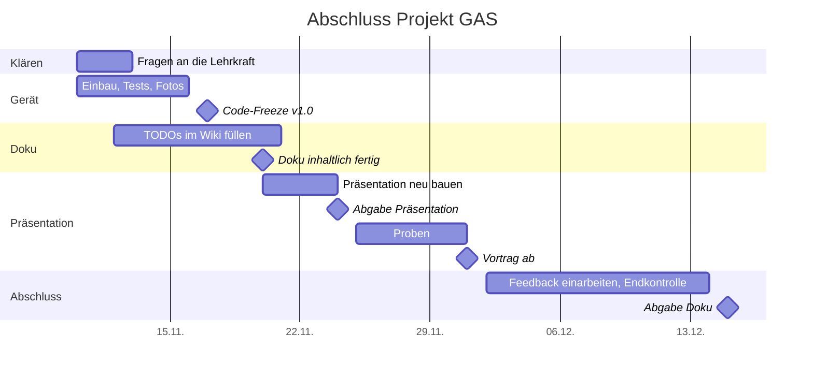

# Abschlussplan — Projekt GAS

Stand: 10.11.2026. Plan für alles, was bis zur Abgabe noch passieren muss.
Grundlage sind die Vorgaben der Lehrkraft (zehn Kapitel, Präsentation, Regeln
zum KI-Einsatz) und der aktuelle Stand im Repository.

Hinter jeder Aufgabe steht, wer sie erledigen kann:

- **(Team)** braucht Hände am Gerät, eure Meinung oder Wissen, das nur ihr habt
- **(Claude)** kann in einer Claude-Code-Sitzung erledigt werden, sobald ihr die
  Angaben liefert
- **(Lehrkraft)** muss gefragt werden

## Termine

| Datum | Was | Bedeutung für uns |
|---|---|---|
| **Di 24.11.2026** | Abgabe Präsentation | Präsentationsdatei fertig und abgegeben |
| **Di 01.12.2026** | Start der Präsentationen | ab hier kann unsere Gruppe dran sein, Gerät muss vorführbereit sein |
| **Di 15.12.2026** | Abgabe Projektdokumentation | Wiki fertig, Sourcecode als Datei, alles abgegeben |

## Roter Faden

Die Präsentation muss **vor** der Dokumentation abgegeben werden. Damit beides
zusammenpasst, gilt diese Reihenfolge:

```text
Gerät fertig + getestet  →  Doku inhaltlich fertig  →  Präsentation aus der Doku bauen
     (bis 15.11.)               (bis 20.11.)              (20.–24.11.)
                                                                │
          Doku abgeben  ←  Feedback aus der Präsentation einarbeiten  ←  vortragen
           (15.12.)                  (bis 13.12.)                        (ab 01.12.)
```

- Die Präsentation erzählt dieselbe Geschichte wie die Doku, in derselben
  Reihenfolge (Kapitel 2 → 9). Wer die Präsentation gesehen hat, findet jede
  Folie in der Doku wieder.
- Zahlen, Fotos und Begriffe stehen zuerst in der Doku und werden von dort in
  die Präsentation übernommen, nicht umgekehrt.
- Die Präsentation wird **komplett neu** gebaut, als letzter großer Schritt.
  Der Prototyp vom 09.11. (Branch `claude/funny-cannon-vqa19g`) dient höchstens
  als Ideenquelle.

## Übersicht



Puffer: zwischen „Doku inhaltlich fertig“ (20.11.) und der Doku-Abgabe
(15.12.) liegen fast vier Wochen. Wenn etwas länger dauert, verschiebt sich die
Doku, **nicht** die Präsentation.

---

## Phase 0 · Sofort klären (bis Fr 13.11.)

Diese Fragen entscheiden, wie die Abgabe aussieht. Am besten in der nächsten
Stunde direkt fragen und die Antworten hier eintragen.

- [ ] **(Lehrkraft)** In welcher Form wird die Doku abgegeben? Reicht der Link
      zum Wiki, oder braucht ihr eine Datei (PDF/Word)?
      → Antwort: ✏️
- [ ] **(Lehrkraft)** Wie wird der Sourcecode abgegeben? (ZIP, Link aufs
      Repository mit Tag `v1.0`, Upload in Moodle/Teams …)
      → Antwort: ✏️
- [ ] **(Lehrkraft)** In welchem Format wird die Präsentation abgegeben?
      PowerPoint, PDF, HTML-Datei im Browser? Mit welchem Rechner wird
      präsentiert (eigener Laptop oder Schul-PC, Beamer-Anschluss)?
      → Antwort: ✏️
- [ ] **(Lehrkraft)** Ist das Arbeitsprotokoll `MDs/entwicklungsverlauf.md`
      (enthält die Prompts im Wortlaut) als Anhang im Repository in Ordnung?
      Im Wiki stehen keine Prompts, es wird nur dorthin verlinkt.
      (Offen seit Schritt 18.)
      → Antwort: ✏️
- [ ] **(Lehrkraft)** Wann ist unsere Gruppe dran? Zählt die Live-Demo in die
      20 Minuten (2 × 10 min) hinein?
      → Antwort: ✏️
- [ ] **(Lehrkraft)** Gibt es ein Zitierformat fürs Quellenverzeichnis?
      → Antwort: ✏️
- [ ] **(Team)** Branch `claude/funny-cannon-vqa19g` (Präsentations-Prototyp):
      Code **nicht** nach `main` übernehmen. Entscheiden, ob die
      Protokolleinträge 21–24 trotzdem ins Protokoll kommen (empfohlen, das ist
      ehrlicher fürs KI-Kapitel). Dann werden der Eintrag zu diesem Plan und die
      Wiki-Karte entsprechend umnummeriert. Den Branch danach als Archiv
      stehen lassen oder löschen.
- [ ] **(Team)** Diesen Branch per Pull Request nach `main` holen, damit der
      Plan und alle folgenden Wiki-Änderungen veröffentlicht werden.

## Phase 1 · Gerät fertig bauen und testen (bis So 15.11.)

Ohne fertiges Gerät keine Fotos, keine Messwerte und keine Demo. Deshalb zuerst.

**Bevor das Gehäuse zugeschraubt wird:**

- [ ] **(Team)** Foto vom **Versuchsaufbau** auf dem großen Breadboard, von
      oben, alle Kabel sichtbar → `wiki/images/aufbau.jpg`. Pflicht laut
      Vorgabe (Kapitel 5). Ist der Aufbau schon abgebaut: Foto vom offenen
      Gehäuse mit Verkabelung und im Wiki ehrlich dazuschreiben.
- [ ] **(Team)** Foto vom **offenen Bedienteil** mit Steckplan-Belegung
      (Mini-Breadboard, Batterie) → `wiki/images/gehaeuse_verkabelt.jpg`
- [ ] **(Team)** Polung an VIN prüfen (kein Verpolungsschutz!), erst dann
      Batterie anstecken

**Einbau:**

- [ ] **(Team)** Bedienteil und Sensorteil nach
      `Schaltplan/steckplan_gehaeuse.svg` verkabeln und schließen
- [ ] **(Team)** Notieren, was beim Druck oder Einbau nicht gepasst hat und wie
      ihr es gelöst habt (für Kapitel 8 und die Präsentation, Stichworte reichen)

**Tests am fertigen Gerät** (Ergebnis im Wiki auf der Seite
[Projektphasen](../wiki/Projektphasen.md) unter „Stand und offene Punkte“
abhaken, Messwerte eintragen):

| # | Test | Erwartet | Ergebnis |
|---|---|---|---|
| T1 | PIN + `#` im Zustand UNSCHARF | 10 s Ausgangsverzögerung, dann Totenkopf | ✏️ |
| T2 | Bewegung im Zustand SCHARF | Sirene 30 s, Totenkopf blinkt | ✏️ |
| T3 | Richtige PIN im Alarm | Sirene aus, Herz | ✏️ |
| T4 | Falsche PIN / falsche Karte im Alarm (Bugfix Schritt 16) | wird ignoriert, Sirene läuft weiter | ✏️ |
| T5 | 3 × falsche PIN im Zustand UNSCHARF | Alarm | ✏️ |
| T6 | Bekannte Karte auflegen | schaltet scharf bzw. unscharf | ✏️ |
| T7 | Admin-Menü: `A` + Admin-PIN, Karte anlernen, löschen | Karte wird gespeichert, bleibt nach Neustart | ✏️ |
| T8 | RFID-Reset `B` mit kurz abgezogenem Leser | Leser antwortet danach wieder (0x91/0x92) | ✏️ |
| T9 | Serieller Monitor beim Start | `free SRAM:` Wert notieren (erwartet ~320 Byte) | ✏️ Byte |
| T10 | Laufzeit mit frischer 9-V-Batterie | grob 3–5 h | ✏️ h |

- [ ] **(Team)** Kurzes **Video** vom kompletten Ablauf (Herz → Karte →
      Totenkopf → Bewegung → Sirene → PIN → Herz). Dient als GIF auf der
      Startseite **und als Ersatz, falls die Live-Demo ausfällt**.
- [ ] **(Team)** Foto vom fertigen Gerät (Bedienteil + Sensorteil) →
      `wiki/images/geraet.jpg`

## Phase 2 · Code-Freeze (bis Di 17.11.)

Ab hier wird die Firmware nicht mehr geändert, sonst stimmen Doku, Präsentation
und 3D-Modell nicht mehr überein.

- [ ] **(Team)** Entscheiden: Fehlerton **3 s** (wie gefordert) oder bei 2 s
      bleiben und begründen. Empfehlung: auf 3 s stellen, dann ist der
      Soll/Ist-Vergleich sauber.
- [ ] **(Claude)** Falls 3 s: `ERROR_TONE_MS` ändern und Viewer,
      `Sourcecode.md`, `Wichtige-Codeabschnitte.md`, `Funktionsbeschreibung.md`
      mitziehen
- [ ] **(Team)** Fehler, die bei den Tests in Phase 1 auffallen, beheben (mit
      Claude), neu testen
- [ ] **(Team)** Endstand kompilieren und aufs Gerät laden, kurzer Test
- [ ] **(Claude)** `Code/alarm_system/alarm_system.ino.bak` aus dem Repository
      entfernen (alte Sicherung, gehört nicht zur Abgabe)
- [ ] **(Team)** Git-Tag `v1.0` auf `main` setzen = abgegebener Stand

## Phase 3 · Doku inhaltlich fertig (bis Fr 20.11.)

Alle `✏️ TODO` im Ordner `wiki/` abarbeiten. Was nur ihr wissen könnt, ist mit
**(Team)** markiert; den Rest kann Claude einarbeiten, sobald die Angaben da
sind. Suche nach allen offenen Stellen:

```bash
grep -rn "TODO" wiki/
```

### Kapitel 1–10 (Pflicht laut Vorgabe)

| Kapitel | Was fehlt | Wer |
|---|---|---|
| 1 Deckblatt (`Home`) | Datum der Abgabe (15.12.2026 statt „Weis keiner“), Foto/GIF vom Gerät, Zahlen „Auf einen Blick“ aktuell halten | Team (Foto), Claude (Rest) |
| 2 Idee und Zielsetzung | Zeitraum (Projektstart + 15.12.2026), K5 Gehäuse auf ✅ setzen, sobald montiert | Team (Projektstart), Claude |
| 3 Funktionsbeschreibung | nur nachziehen, falls Fehlerton/Zeiten sich ändern | Claude |
| 4 Verwendete Bauteile | prüfen, ob Batterie, Clip, Mini-Breadboard und Kabel vollständig drin sind | Team prüft |
| 5 Aufbau und Schaltplan | Foto vom Versuchsaufbau, Laufzeit eintragen, Cirkit-Schaltplan auf VIN umstecken und neu exportieren | Team |
| 6 Sourcecode | Abgabeform eintragen (aus Phase 0), Fehlerton-Entscheidung | Team entscheidet, Claude schreibt |
| 7 Wichtige Codeabschnitte | gemessenen SRAM-Wert eintragen | Team misst, Claude schreibt |
| 8 Herausforderungen | wie ihr den SH1106 erkannt habt, Probleme beim RC522-Verdrahten, eigene Probleme (Druck, Einbau, Teamarbeit) | **Team** |
| 9 Fazit und Ausblick | Soll/Ist (Zeit, Kosten, Gehäuse), Fazit 2–3 Sätze, **Reflexion selbst schreiben, ohne KI**, 2–4 Erweiterungsideen auswählen | **Team** |
| 10 Quellenverzeichnis | Keypad- und Buzzer-Quelle (Händlerseite), Library-Versionen (Library Manager → „Installiert“), Slicer, eigene Tutorials/Videos, Abrufdatum | Team sammelt, Claude formatiert |

### Anhang

| Seite | Was fehlt | Wer |
|---|---|---|
| Team und Rollen | wer hat was gemacht, wie habt ihr euch abgestimmt, Drucker/Slicer | **Team** |
| Zeitplan | gab es eine Planung? Meilensteine mit Datum (Projektstart, `hardware_test`, RFID verdrahtet, Gehäuse montiert), Präsentation und Abgabe | Team liefert Daten, Claude trägt ein |
| Kosten | Preise und Bezugsquellen, was von der Schule kam | **Team** |
| Projektphasen | Stand und offene Punkte abhaken, Foto vom fertigen Gerät, Testergebnisse | Team, Claude |
| KI-Einsatz | Tabelle prüfen, wie ihr den Code geprüft habt, was die KI falsch gemacht hat | **Team** |
| Entwicklungsverlauf | läuft automatisch mit jedem Schritt mit | Claude |

### Außerhalb des Wikis

- [ ] **(Team)** `Teile.xlsx`: 9-V-Batterie, Clip, Mini-Breadboard SYB-170
      ergänzen, Preise passend zur Kostenseite
- [ ] **(Claude)** PDF-Anleitung `Anleitung/Mini Security System Manual.pdf`
      aus `MDs/anleitung.md` neu erzeugen (Abschnitt Stromversorgung fehlt)
- [ ] **(Team)** Social Preview neu hochladen (Settings → General → Social
      preview, Datei `docs/social-preview.png`)
- [ ] **(Claude)** README auf den Endstand prüfen (Status Gehäuse, Links)

## Phase 4 · Präsentation neu bauen (Fr 20.11. – Di 24.11.)

Erst wenn die Doku steht. Inhalte werden aus der Doku übernommen.

### Rahmen

- Mindestens **20 Minuten** (2 Personen × 10 min), jeder hat einen
  **erkennbar eigenen Teil**
- Ablauf nach Vorgabe: Idee → Aufbau und Code → Herausforderungen → Fazit →
  Live-Demo
- **Jeder muss den ganzen Code erklären können**, nicht nur seinen Teil. Das
  wird in der Präsentation geprüft.
- Format nach der Antwort aus Phase 0. Egal welches Format: zusätzlich ein
  **PDF als Sicherung** abgeben und auf einem USB-Stick mitbringen.

### Vorschlag für den Ablauf (≈ 22 min + Fragen)

Die Aufteilung ist nur ein Vorschlag, entscheidet selbst, wer was übernimmt.

| # | Teil | Inhalt | Doku | Min | Wer |
|---|---|---|---|---:|---|
| 1 | Einstieg | Problem und Idee, Ziel in einem Satz, Muss-/Kann-Anforderungen | Kap. 2 | 2 | Person A |
| 2 | So funktioniert's | Zustände aus Anwendersicht: Herz, Ausgangsverzögerung, Totenkopf, Alarm, Admin | Kap. 3 | 2 | Person A |
| 3 | Bauteile und Aufbau | Bauteile, Schaltplan, Pin-Zuordnung (I²C, SPI), Foto Versuchsaufbau → Gehäuse, Batterie an VIN | Kap. 4, 5 | 4 | Person B |
| 4 | Code I | Zustandsautomat, nicht-blockierende Töne mit `millis()` | Kap. 7 | 3 | Person A |
| 5 | Code II | Keypad selbst scannen statt Library, RFID mit EEPROM und Admin-Menü, RFID-Polling alle 200 ms | Kap. 7 | 3 | Person B |
| 6 | Herausforderungen | SH1106 statt SSD1306, knapper SRAM (Pixelmüll, Neustarts), `SPI.begin()` und der Buzzer an D10, RC522 nur 3,3 V, Bugfix Alarm, Gehäuse | Kap. 8 | 4 | beide, je 2 Punkte |
| 7 | Fazit und Ausblick | Soll/Ist, was wir gelernt haben, Erweiterungen, kurz: wie wir KI genutzt haben | Kap. 9 | 2 | Person B |
| 8 | Live-Demo | nach Demo-Drehbuch unten | — | 3–4 | A bedient, B erklärt |
| 9 | Fragen | | | | beide |

Jede Folie bekommt in der Ecke die Kapitelnummer aus der Doku, das ist der
sichtbare rote Faden.

### Demo-Drehbuch

1. Gerät läuft, Herz auf dem Display (UNSCHARF)
2. Karte auflegen → OK-Ton, 10 s Ausgangsverzögerung → Totenkopf (SCHARF)
3. Hand vor den Bewegungsmelder → Sirene, Totenkopf blinkt (ALARM)
4. Falsche PIN eingeben → wird ignoriert, Sirene läuft weiter
5. Richtige PIN + `#` → Herz (UNSCHARF)
6. Optional, wenn Zeit ist: `A` + Admin-PIN, neue Karte anlernen

**Plan B**, falls die Hardware streikt: Video aus Phase 1 zeigen, danach das
3D-Modell im Browser (https://bbz-aifs51.github.io/LF7-Projekt_GAS/) — dort läuft
dieselbe Logik.

### Aufgaben

- [ ] **(Team)** Format und Aufteilung festlegen
- [ ] **(Claude)** Präsentation nach dem Ablauf oben bauen, Inhalte aus dem Wiki
- [ ] **(Team)** Folien durchgehen, in eigenen Worten Stichpunkte für die
      Sprechernotizen schreiben
- [ ] **(Team)** Präsentation **auf dem Präsentationsrechner** testen
      (läuft sie offline? passt die Auflösung?)
- [ ] **(Team)** PDF-Sicherung erzeugen, **Abgabe bis Di 24.11.**

## Phase 5 · Proben und Vortrag (25.11. – ab 01.12.)

- [ ] **(Team)** Mindestens zwei komplette Durchläufe mit Stoppuhr (Ziel 20–24 min)
- [ ] **(Team)** Gegenseitig abfragen: Jeder erklärt die Codeabschnitte des
      anderen. Typische Fragen üben:
  - Warum keine Keypad-Library? (SRAM, ~120 Byte, Neustarts)
  - Warum `millis()` statt `delay()`?
  - Warum hängt der Bewegungsmelder an A2 und nicht mehr an D11?
  - Warum läuft der RC522 an 3,3 V, und warum funktioniert SPI trotzdem mit 5-V-Logik?
  - Wo sind die Karten gespeichert, und was passiert nach einem Neu-Hochladen?
  - Was hat die KI gemacht, was habt ihr selbst gemacht und geprüft?
- [ ] **(Team)** Packliste am Vortag:
  - [ ] **frische 9-V-Batterie** einsetzen + Ersatzbatterie (Laufzeit nur wenige Stunden)
  - [ ] RFID-Karten (mindestens eine angelernt, eine unbekannte für die Demo)
  - [ ] PIN und Admin-PIN auf einem Zettel
  - [ ] USB-Kabel (Typ B) und Laptop mit Arduino IDE, falls neu geladen werden muss
  - [ ] Präsentation als Datei + PDF auf USB-Stick
  - [ ] Demo-Video offline gespeichert

## Phase 6 · Feedback einarbeiten und abgeben (02.12. – Di 15.12.)

- [ ] **(Team)** Fragen und Hinweise aus der Präsentation notieren
- [ ] **(Claude)** Hinweise ins Wiki einarbeiten (z. B. Fragen, die die Doku
      noch nicht beantwortet hat)
- [ ] **(Team)** Zeitplan und Meilensteine auf den tatsächlichen Stand bringen
      (Präsentation gehalten am ✏️)
- [ ] **(Team + Claude)** Endkontrolle:
  - [ ] `grep -rn "TODO" wiki/` findet nichts mehr
  - [ ] alle Bilder im Wiki laden, alle Links funktionieren
  - [ ] Pins, Zeiten und Zahlen sind überall gleich (Firmware, Wiki, README,
        3D-Modell, Präsentation)
  - [ ] keine Prompts im Wiki (Vorgabe)
  - [ ] Rechtschreibung
- [ ] **(Claude)** Falls eine Datei verlangt ist (Phase 0): Wiki als PDF
      exportieren, Sourcecode als ZIP packen
- [ ] **(Team)** Tag `v1.0` prüfen bzw. neu setzen, falls nach dem Code-Freeze
      noch etwas geändert wurde
- [ ] **(Team)** **Abgabe bis Di 15.12.2026**

---

## Abgabepaket (Endstand)

| Teil | Wo | Form |
|---|---|---|
| Projektdokumentation (Kap. 1–10 + Anhang) | GitHub-Wiki, Quelle `wiki/` | Link, ggf. zusätzlich PDF |
| Sourcecode | `Code/` im Repository, Tag `v1.0` | separate Datei(en) / ZIP, in der Doku nur verlinkt |
| Präsentation | ✏️ (nach Phase 0) | Datei + PDF-Sicherung |
| Ergänzend | 3D-Modell (GitHub Pages), Bedienungsanleitung (PDF), Gehäuse-STLs, `Teile.xlsx` | im Repository |

## Was bewusst nicht mehr passiert

Schulprojekt, die Zeit ist knapp:

- keine neuen Funktionen in der Firmware nach dem Code-Freeze
- kein Neudruck des Gehäuses, außer etwas passt gar nicht
- die Erweiterungsideen landen in Kapitel 9 als Ausblick, nicht im Code
