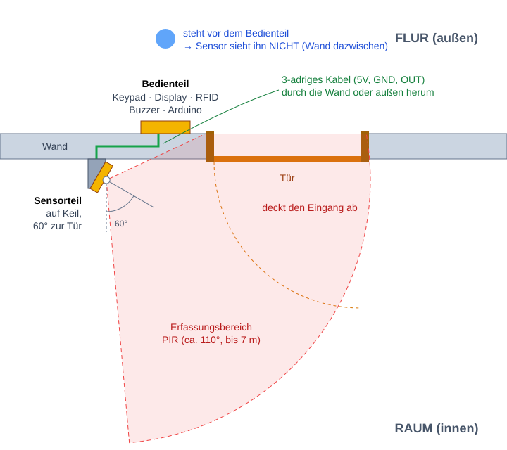
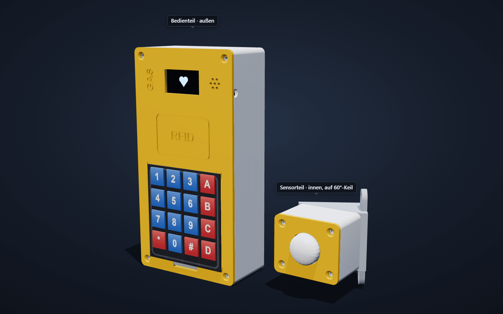
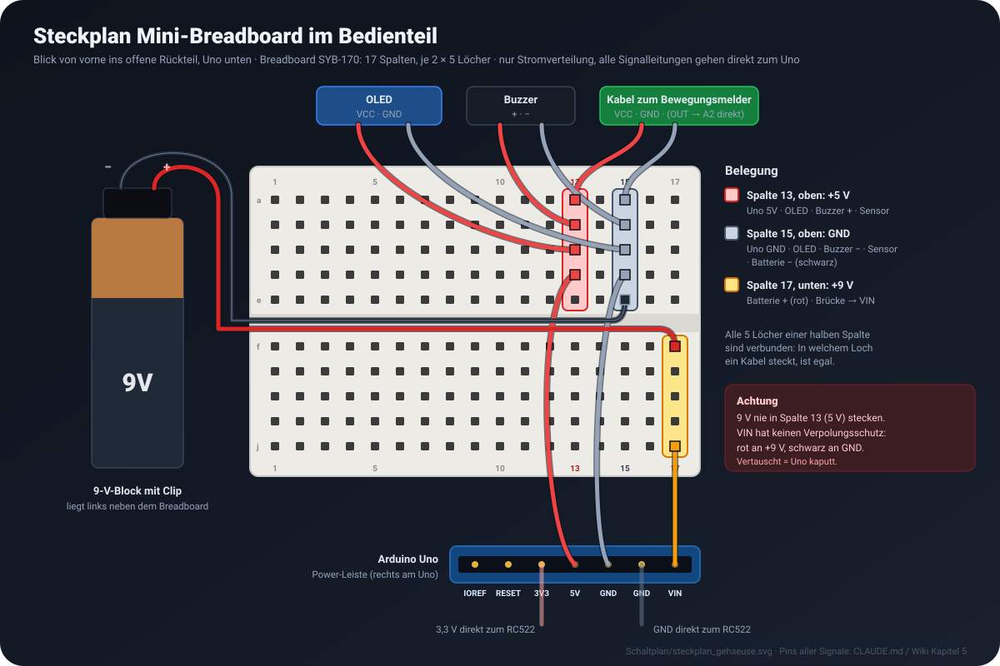
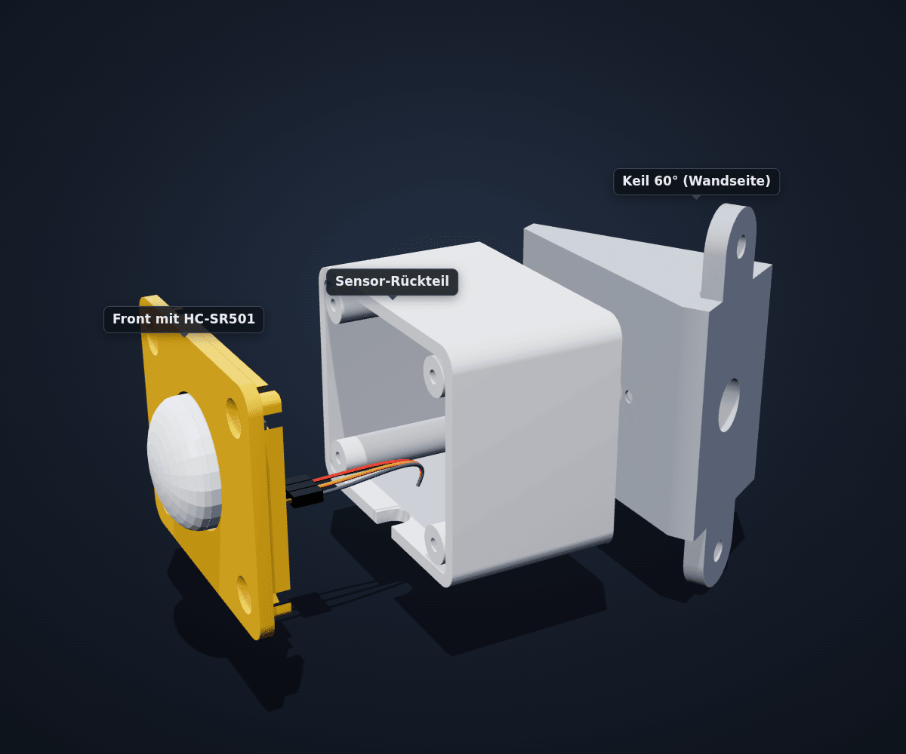
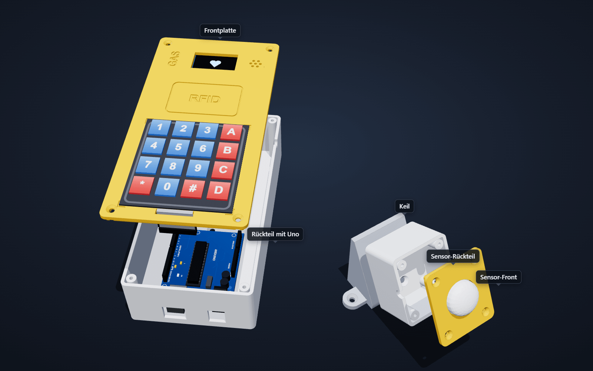
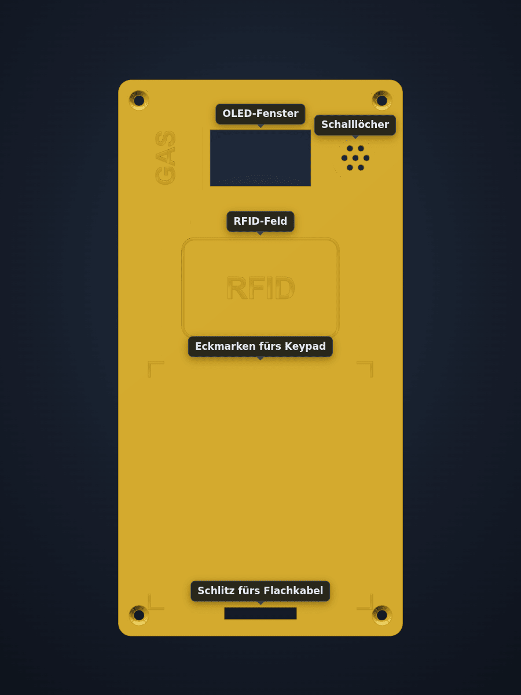
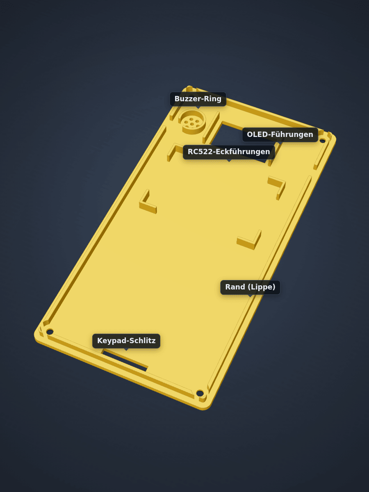
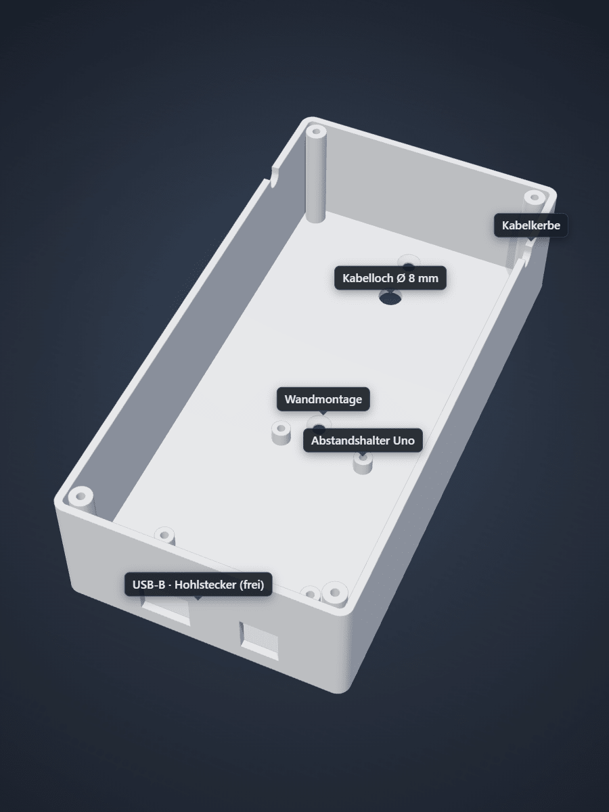
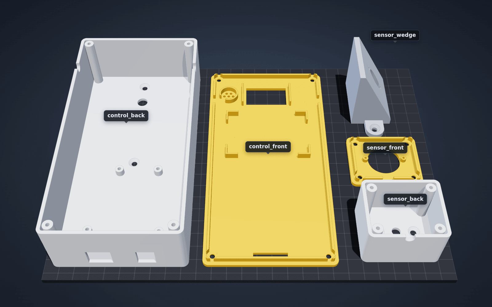

# Gehäuse — Planung und Entwurf

3D-druckbares Gehäuse für das Mini-Sicherheitssystem. Geschrieben für
Einsteiger: Es wird nichts an Vorwissen über 3D-Druck vorausgesetzt.

- Modell (zum Anpassen): [../Gehaeuse/gehaeuse.scad](../Gehaeuse/gehaeuse.scad)
- Fertige Druckdateien: [../Gehaeuse/stl/](../Gehaeuse/stl/)
- Bilder: [../Gehaeuse/bilder/](../Gehaeuse/bilder/)
- 3D-Ansicht im Browser, Tab „Enclosure“: <https://bbz-aifs51.github.io/LF7-Projekt_GAS/#enclosure>
  — alle Bauteile im Gehäuse, das Gehäuse lässt sich massiv, durchsichtig
  (X-ray) oder ausgeblendet zeigen und aufklappen. Die Firmware läuft dabei
  weiter: Tasten drücken, Karte vorhalten, Bewegungsmelder anklicken.

---

## Teil 1 — Planung

### Anforderungen

1. Keypad, Display, RFID-Leser und Buzzer sitzen **außen** an der Tür bzw.
   neben dem Türrahmen — dort wird ent- und verriegelt.
2. Der Bewegungssensor sitzt **auf der anderen Seite, im Raum**. Er soll erst
   auslösen, wenn jemand den Raum betritt, nicht schon, wenn man zum
   Entsperren vor der Tür steht.
3. Druckbar ohne Erfahrung: keine Stützstrukturen, passt auf kleine Drucker,
   Befestigung mit einfachen Schrauben und Heißkleber.
4. Keine Änderung an der Firmware nötig. Einzige Änderung an der Verdrahtung:
   Die 9-V-Batterie hängt an **VIN** statt am Hohlstecker, damit sie mit ins
   Gehäuse passt (siehe [Stromversorgung](#stromversorgung-9-v-batterie-an-vin)).

### Konzept: zwei Gehäuse, ein Kabel



- **Bedienteil** (außen): Keypad, OLED, RC522, Buzzer und der Arduino Uno.
- **Sensorteil** (innen): nur der HC-SR501.
- Verbunden über ein **3-adriges Kabel** (5V, GND, OUT → A2). Der Bewegungs-
  sensor braucht nur diese drei Leitungen, ein langes Kabel ist für das
  digitale Signal kein Problem.

**Warum das funktioniert:** Ein PIR-Sensor „sieht“ Wärmestrahlung nur in
direkter Sichtlinie. Wände, Türen und sogar normales Glas blockieren sie.
Der Sensor zeigt in den Raum, die Wand steht zwischen ihm und der Person am
Bedienteil — die kann er also gar nicht erfassen. Erst wer die Tür öffnet
und eintritt, läuft in den Erfassungsbereich.

**Warum schräg:** Flach an der Wand schaut der Sensor geradeaus in den Raum,
der Bereich direkt vor der Tür liegt dann am Rand oder außerhalb seines
Sichtfelds. Deshalb sitzt das Sensorteil auf einem **Keil (60°)** und ist
stark zur Tür gedreht. Bei ca. 110° Öffnungswinkel läuft die türseitige Kante
des Erfassungsbereichs dann schräg in die Wand hinein (ca. 25°), die andere
zeigt fast gerade in den Raum. Der Eingang liegt damit komplett und bis dicht
an die Wand im Sichtfeld — durch die Wand nach außen sieht er trotzdem nicht.

### Bedienteil (außen)



Größe: **90 × 176 × 45 mm** (B × H × T). Zwei Druckteile: Rückteil (Wanne) und
Frontplatte.

| Bereich | Bauteil | Befestigung |
|---|---|---|
| oben | OLED hinter einem Fenster (32 × 18 mm) | seitliche Führungen, nach oben/unten schiebbar bis das Bild mittig sitzt, dann Heißkleber |
| oben rechts | Buzzer hinter 7 Schalllöchern | Ring als Halter + Heißkleber |
| Mitte | RC522 hinter der Frontplatte, Feld „RFID“ eingraviert | vier Eckführungen + Heißkleber. Die Karte liest durch 2,4 mm Kunststoff problemlos |
| unten | Folien-Keypad **außen aufgeklebt** (Klebefolie auf der Rückseite) | Eckmarken zeigen die Position, das Flachkabel geht durch einen Schlitz direkt darunter |
| hinten | Arduino Uno auf 4 Abstandshaltern, USB-/Strombuchse zeigt nach unten | 4 Schrauben |
| hinten, über dem Uno | Mini-Breadboard SYB-170 (Verteilung 5 V, GND, 9 V), zwischen unterem Montageloch und Kabelloch | Klebefolie auf der Unterseite |
| hinten, links neben dem Breadboard | 9-V-Block auf der schmalen Seite, Clip oben | doppelseitiges Klebeband oder Klettband (zum Wechseln) |

Das RFID-Feld liegt bewusst **nicht** hinter dem Keypad: Die Folientastatur hat
Leiterbahnen aus Metall, die das Funkfeld stören würden.

Öffnungen im Rückteil:

- unten: Aussparungen für **USB-B** (nur zum Hochladen) und **Hohlstecker**.
  Der Hohlstecker bleibt frei, die Batterie sitzt innen an VIN.
- Rückwand: **Kabelloch Ø 8 mm** (Kabel direkt durch die Wand zum Sensor)
- links und rechts: je eine **Kabelkerbe** am Rand (Kabel außen auf der Wand
  verlegt — nimm die Seite, die zur Tür zeigt)
- Rückwand: 2 **Löcher für die Wandmontage** (Schraubenkopf versenkt, die
  Rückseite bleibt flach — geht also auch mit Klebestreifen)

### Stromversorgung: 9-V-Batterie an VIN

Am Hohlstecker würde der Batterieclip unten aus dem Gehäuse ragen, die Batterie
hinge außen dran. Deshalb sitzt der **9-V-Block innen** links neben dem
Breadboard und speist den Uno über den Pin **VIN**. Der Uno macht daraus mit
seinem eigenen Regler die 5 V für alle Module.



| Spalte (von links) | Hälfte | Netz | Was steckt drin |
|---|---|---|---|
| 13 | oben | +5 V | Brücke vom Uno-Pin 5V, OLED VCC, Buzzer +, Sensorkabel VCC |
| 15 | oben | GND | Brücke vom Uno-Pin GND, OLED GND, Buzzer −, Sensorkabel GND, **Batterie − (schwarz)** |
| 17 | unten | +9 V | **Batterie + (rot)**, Brücke zum Uno-Pin **VIN** |

Alle anderen Leitungen (Keypad, OLED SDA/SCL, RC522, Buzzer-Signal, Sensor
OUT → A2) gehen wie bisher direkt an den Uno, der RC522 bekommt 3,3 V und GND
direkt vom Uno.

> **Achtung:**
> - **VIN hat keinen Verpolungsschutz.** Die Schutzdiode sitzt nur hinter dem
>   Hohlstecker. Rot und schwarz vertauscht = Uno kaputt. Erst prüfen, dann
>   den Clip auf die Batterie stecken.
> - **9 V nie in Spalte 13** (5 V) stecken, das zerstört OLED, Buzzer und Sensor.
> - Die blanken Enden des Batterieclips halten im Breadboard. Sitzen sie zu
>   locker, je ein Stück Jumper-Kabel anlöten oder mit Schrumpfschlauch
>   verstärken.

**Ein/Aus und Laufzeit:** Einen Schalter gibt es nicht, ausgeschaltet wird
durch Abziehen des Clips. Ein frischer 9-V-Block (Alkali) hält grob **3–5
Stunden** (die Schaltung zieht um die 100 mA). Das reicht für Tests und die
Vorführung, für Dauerbetrieb nicht. Unter etwa 7 V arbeitet der Spannungsregler
des Uno nicht mehr sauber, dann Batterie wechseln.

**Hochladen:** USB-Kabel durch die Öffnung unten anstecken, die Batterie darf
dranbleiben. Der Uno schaltet automatisch auf VIN um, sobald dort mehr als
etwa 6,6 V anliegen.

### Sensorteil (innen)



Größe: **52 × 44 × 35 mm**, dazu der Keil (5–50 mm dick). Die Linse (weiße
Kuppel) schaut vorne heraus, die Platine hängt an zwei Zapfen an der
Frontplatte. Nach dem Abnehmen der Front kommt man an die beiden Drehregler
(Empfindlichkeit, Haltezeit). Kabel raus durch Loch in der Rückwand (der Keil
hat an derselben Stelle ein Ø-10-mm-Loch) oder Kerbe unten.

Drei Druckteile: **Keil**, Rückteil, Frontplatte. Der Keil wird mit zwei
Laschen (oben/unten) an die Wand geschraubt, das Rückteil mit 2 Schrauben auf
den Keil. Das **dünne Ende zeigt zur Tür**. Liegt die Tür auf der anderen
Seite, den Keil einfach um 180° gedreht anschrauben — er ist oben/unten
symmetrisch, das Rückteil passt in beiden Lagen. Den Winkel kann man über
`su_angle` in der `.scad`-Datei ändern.

### Montageort

- **Bedienteil:** außen neben dem Türrahmen auf der Schlossseite, Oberkante
  etwa auf **1,40 m** — dann ist das Display gut lesbar.
- **Sensorteil:** innen auf **derselben Wand** neben der Tür, etwa
  **1,5–2 m hoch**, auf dem Keil zur Tür gedreht. Am besten auf der Seite
  **gegenüber dem Türscharnier** — sonst steht die geöffnete Tür genau
  zwischen Sensor und Eingang. Nicht auf Heizkörper, Fenster mit direkter
  Sonne oder Lüftungen richten (Fehlalarme durch Wärme).
- **Kabel** nie durch den Türspalt auf der Schlossseite führen (wird
  eingeklemmt). Entweder ein kleines Loch durch die Wand (Ø 6–8 mm) oder
  mit Kabelclips außen um den Türrahmen herum.
- **Für die Präsentation:** Ein Brett oder eine stabile Pappe spielt die Wand:
  Bedienteil vorne, Sensorteil hinten, Kabel durch ein Loch im Brett.

### Designentscheidungen für den 3D-Druck

- **Jedes Teil liegt mit einer großen, flachen Seite auf dem Druckbett.** Die
  Frontplatte wird mit der Sichtseite nach unten gedruckt → glatte Front,
  Gravuren gelingen sauber. Keine Stützstrukturen nötig.
- Die Frontplatte hat einen umlaufenden **Rand (Lippe)**, der in das Rückteil
  greift — so rutscht nichts und sie sitzt von selbst mittig.
- **Schrauben direkt in den Kunststoff:** Die Löcher haben 2,5 mm, eine 3-mm-
  Schraube schneidet sich ihr Gewinde selbst. Keine Gewindeeinsätze nötig.
- Wandstärke 2,4 mm = 6 Druckbahnen bei der üblichen 0,4-mm-Düse. Stabil,
  aber nicht übertrieben.
- **Positionier-Führungen statt exakter Halter:** Die Maße der Module kommen
  aus Datenblättern, und Klone weichen gern ein paar Zehntel ab. Führungen +
  Heißkleber verzeihen das.
- Größtes Teil 90 × 176 mm → passt auch auf kleine Drucker (180 × 180 mm Bett).

---

## Teil 2 — Entwurf



Alle Bilder auf dieser Seite außer `montage.svg` (von Hand gezeichnet) rendert
[../tools/render.mjs](../tools/render.mjs) aus dem 3D-Viewer, also aus genau den
STL-Dateien, die gedruckt werden.

| Datei | Teil | Druckzeit (ca.) | Material (ca.) |
|---|---|---|---|
| [control_back.stl](../Gehaeuse/stl/control_back.stl) | Bedienteil, Rückteil | 6–8 h | 100 g |
| [control_front.stl](../Gehaeuse/stl/control_front.stl) | Bedienteil, Frontplatte | 2–3 h | 45 g |
| [sensor_back.stl](../Gehaeuse/stl/sensor_back.stl) | Sensorteil, Rückteil | 1,5–2 h | 25 g |
| [sensor_front.stl](../Gehaeuse/stl/sensor_front.stl) | Sensorteil, Frontplatte | 20–30 min | 6 g |
| [sensor_wedge.stl](../Gehaeuse/stl/sensor_wedge.stl) | Sensorteil, Keil (60°) | 1,5–2 h | 20 g |

Zusammen rund 200 g PLA, also ca. 4–5 € Material. Die Zeiten hängen stark vom
Drucker ab — der Slicer zeigt den genauen Wert an.

| Frontplatte von vorne | Frontplatte von innen | Rückteil |
|---|---|---|
|  |  |  |

### Schritt 1 — Vor dem Drucken nachmessen

Die Maße stammen aus Datenblättern, nicht vom echten Aufbau. Einmal mit Lineal
oder Messschieber prüfen. Weicht etwas um **mehr als 1 mm** ab, den Wert in der
`.scad`-Datei ändern (siehe Schritt 6):

| Was messen | Variable | Annahme |
|---|---|---|
| Folien-Keypad Breite × Höhe (ohne Flachkabel) | `keypad_w`, `keypad_h` | 69,5 × 77 mm |
| Stecker am Ende des Keypad-Flachkabels (muss durch den Schlitz) | `ribbon_slot_w`, `ribbon_slot_h` | Schlitz 23 × 4 mm |
| RC522-Platine | `rfid_w`, `rfid_h` | 60 × 40 mm |
| OLED-Platine | `oled_w`, `oled_h` | 36 × 34 mm |
| Durchmesser des Buzzers (schwarzer Zylinder) | `buzzer_d` | 12 mm |
| HC-SR501: Linse Ø und Abstand der 2 Befestigungslöcher | `pir_dome_d`, `pir_hole_dist` | 23 mm / 28 mm |

Außerdem kurz nachsehen:

- **OLED:** Zeigen die 4 Pins nach hinten (weg vom Display)? Sonst stoßen sie
  an die Frontplatte.
- **RC522:** Dem Modul liegen meist eine gerade und eine **gewinkelte
  Stiftleiste** bei. Die gewinkelte spart Platz nach hinten. Ist schon eine
  gerade eingelötet, geht es auch so, die Kabel müssen dann etwas gebogen werden.

**Tipp:** Zuerst nur die kleine Sensor-Frontplatte drucken (≈ 30 min) und
prüfen, ob die Linse durchpasst und die Löcher sitzen. So sieht man schnell,
ob der Drucker maßhaltig druckt, bevor die großen Teile dran sind.

### Schritt 2 — Wo drucken?

- Schul-/Ausbildungsbetrieb-Drucker, Makerspace oder FabLab in der Nähe,
  manche Stadtbibliotheken
- Bekannte mit Drucker — die STL-Dateien reichen, mehr braucht niemand
- Online-Druckdienst (STL hochladen, Material PLA wählen)

### Schritt 3 — Slicen (STL → Druckdatei)

Ein Drucker kann STL nicht direkt drucken. Ein **Slicer** zerlegt das Modell in
Schichten und erzeugt die Druckdatei (G-Code). Kostenlos: PrusaSlicer, Bambu
Studio, Orca Slicer oder Cura — je nachdem, welcher Drucker es ist.

1. STL-Datei in den Slicer ziehen.
2. **Nicht drehen** — die Teile liegen schon richtig (große flache Seite unten,
   Frontplatten mit der Sichtseite nach unten, Keil mit der Wandseite unten —
   die Schräge oben braucht keine Stützen). So sehen sie im Slicer aus:

   

3. Einstellungen:

| Einstellung | Wert |
|---|---|
| Material | **PLA** (am einfachsten zu drucken) |
| Düse | 0,4 mm (Standard) |
| Schichthöhe | 0,2 mm |
| Wände / Perimeter | 3 |
| Füllung (Infill) | 15–20 % |
| Stützstrukturen (Supports) | **aus** |
| Brim / Rand | aus. Nur beim großen Rückteil einschalten, falls sich die Ecken vom Bett lösen |

4. „Slicen“ klicken, Druckdatei auf den Drucker (USB-Stick, SD-Karte oder WLAN).
5. Die **erste Schicht beobachten**: Sie muss sauber am Bett haften. Bei der
   Frontplatte entstehen in der ersten Schicht die Gravuren („RFID“, „GAS“,
   Eckmarken).

### Schritt 4 — Einkaufsliste

| Anzahl | Teil | Wofür |
|---|---|---|
| 8 | Senkkopf-Schraube 3 × 12 mm (Spanplattenschraube oder M3 × 12) | Frontplatten an beide Gehäuse |
| 4 | Schraube 3 × 8 mm mit flachem Kopf (Linsenkopf) | Arduino Uno |
| 2 | Schraube M2 × 6 mm | HC-SR501 (alternativ Heißkleber) |
| 2 | Senkkopf-Schraube 3 × 10 mm | Sensor-Rückteil auf den Keil (nicht länger, sonst kommt die Spitze hinten raus) |
| 4 | Senkkopf-Holzschraube 3,5–4 mm + Dübel | Wandmontage (alternativ: Powerstrips / Montageklebeband) |
| 1 | 3-adriges Kabel, Länge je nach Weg (ca. 0,3 m durch die Wand, 1,5–2 m außen herum) + Dupont-Stecker | Verbindung zum Sensor |
| 1 | Mini-Breadboard SYB-170 (170 Kontakte) | 5 V, GND und 9 V verteilen |
| 1 | 9-V-Block (Alkali) + Batterieclip mit offenen Enden | Stromversorgung über VIN |
| 1 | Klettband oder doppelseitiges Klebeband | Batterie im Rückteil |
| 1 | USB-B-Kabel | nur zum Hochladen |
| — | Heißklebepistole | Module fixieren |

### Schritt 5 — Zusammenbau

**Bedienteil:**

1. Frontplatte: Keypad-Folie abziehen, Flachkabel mit Stecker durch den
   Schlitz fädeln, Keypad an den vier Eckmarken ausrichten und festdrücken.
2. RC522 in die Eckführungen legen (flache Seite zur Front), mit zwei Punkten
   Heißkleber fixieren.
3. Buzzer in den Ring stecken, Heißkleber.
4. OLED zwischen die Führungen, Glas zur Front. Einschalten, das Bild im
   Fenster mittig schieben, dann erst festkleben.
5. Uno mit 4 Schrauben auf die Abstandshalter im Rückteil schrauben (Buchsen
   zeigen zu den Aussparungen unten).
6. Mini-Breadboard auf die Rückwand über dem Uno kleben (zwischen dem unteren
   Montageloch und dem Kabelloch).
7. 9-V-Block links neben dem Breadboard mit Klettband befestigen, Clip oben.
8. Verkabeln: Signalleitungen wie bisher direkt an den Uno (Pin-Tabelle in
   [../CLAUDE.md](../CLAUDE.md)), Strom nach dem
   [Steckplan](#stromversorgung-9-v-batterie-an-vin). Das Sensorkabel durch
   Kabelloch oder Kerbe hereinführen: VCC und GND ins Breadboard, OUT an A2.
   Den Batterieclip **zuletzt** anstecken, vorher Polung prüfen.
9. **Erst testen**, dann Frontplatte aufsetzen und mit 4 Schrauben festziehen.
   Nicht zu fest — Kunststoffgewinde überdreht leicht.

**Sensorteil:**

1. HC-SR501 mit der Linse durch die Öffnung stecken und mit 2 M2-Schrauben
   an die Zapfen schrauben (oder Heißkleber).
2. Tipp zu den Reglern: Haltezeit-Regler (Time) ganz gegen den Uhrzeigersinn
   = kürzeste Zeit (≈ 3 s), Jumper auf **H** (wiederholtes Auslösen).
3. Kabel anstecken (VCC, OUT, GND), durch das Loch oder die Kerbe führen,
   Frontplatte festschrauben.
4. Nach dem Einschalten braucht der HC-SR501 **etwa eine Minute zum
   Aufwärmen**, in der Zeit meldet er manchmal Bewegung. Bei der Vorführung
   einplanen.

**Montage:** Bedienteil-Rückteil und Sensor-Keil zuerst an die Wand
(Schraubenköpfe sitzen versenkt; beim Keil das dünne Ende zur Tür), dann das
Sensor-Rückteil mit 2 Schrauben 3 × 10 mm auf den Keil. Danach Elektronik
rein und zuschrauben.

### Schritt 6 — Anpassen in OpenSCAD (nur wenn nötig)

Das Gehäuse ist in **OpenSCAD** gezeichnet — ein kostenloses CAD-Programm, in
dem das Modell als Text beschrieben wird. Deshalb lässt es sich über Zahlen
ändern, ohne zeichnen zu können.

1. OpenSCAD herunterladen: <https://openscad.org/downloads.html>
2. [../Gehaeuse/gehaeuse.scad](../Gehaeuse/gehaeuse.scad) öffnen.
3. Menü **Fenster → Customizer** einblenden. Dort stehen alle Maße als
   Eingabefelder, oben unter „Part selection“ wählt man das Teil.
4. Wert ändern, **F5** = schnelle Vorschau (`assembly` zeigt alles
   zusammengebaut mit den Modulen).
5. Zum Exportieren: ein Teil wählen (z. B. `control_front`), **F6** (Rendern,
   dauert ein paar Sekunden), dann **F7** bzw. *Datei → Export → STL*.
6. Danach 3D-Viewer und Bilder nachziehen (braucht [Node.js](https://nodejs.org)):

   ```sh
   node tools/stl2viewer.mjs     # STLs -> docs/viewer/enclosure.js
   npm install --no-save playwright && npx playwright install chromium   # nur einmal
   node tools/render.mjs         # Bilder in Gehaeuse/bilder/, README-Banner, Social Preview
   ```

   Ändert sich dabei die Lage von Bauteilen im Gehäuse (z. B. über `keypad_h`),
   auch die Formeln in `buildCase()` in [../docs/viewer/index.html](../docs/viewer/index.html)
   anpassen — sie sind aus `gehaeuse.scad` übernommen.

Die Gesamthöhe des Bedienteils berechnet sich automatisch aus Keypad, RFID und
OLED. Wird also z. B. `keypad_h` größer, wächst das Gehäuse mit.

### Offene Punkte / Annahmen

- Alle Modulmaße aus Datenblättern, **nicht am echten Aufbau gemessen**
  (siehe Schritt 1).
- **Gedruckt** (Stand 28.10.2026). Noch offen: ob Frontplatte und Rückteil
  sauber zusammenpassen (0,3 mm Spiel, sonst `clr` anpassen) und ob alle
  Module in ihre Führungen passen.
- Batterie und Mini-Breadboard sind nicht Teil der Druckteile, ihre Lage im
  Modell (`bb_cy`, `bat_y`) ist ein Vorschlag nach dem Foto vom Aufbau.
- Die Uno-Maße (Lochbild, Buchsen) sind die offiziellen Maße des Uno R3 und
  sollten stimmen.
