<!-- Diese Seite wird automatisch aus dem Ordner wiki/ im Repository erzeugt. Änderungen im Wiki-Editor werden beim nächsten Abgleich überschrieben. Bearbeiten: https://github.com/BBZ-AIFS51/LF7-Projekt_GAS/tree/main/wiki -->

  

  
  
  
  

# Projekt GAS – Mini-Sicherheitssystem

<b>Schulprojekt · Lernfeld 7 · Klasse AIFS51 · Hugo und Jan</b>

Eine kleine Alarmanlage auf einem Arduino Uno R3, gebaut im Lernfeld 7. Scharf-
und unscharf geschaltet wird mit einer PIN am 4x4-Keypad oder mit einer
RFID-Karte. Ist die Anlage scharf, löst der Bewegungsmelder eine 30-sekündige
Sirene aus. Das OLED zeigt nur Symbole: ein Herz (unscharf), einen Totenkopf
(scharf) und einen blinkenden Totenkopf (Alarm). Karten werden direkt am Gerät
angelernt, ganz ohne PC.

  <a href="https://bbz-aifs51.github.io/LF7-Projekt_GAS/"><b>▶ 3D-Modell im Browser ausprobieren</b></a>
  &nbsp;·&nbsp; <a href="https://github.com/BBZ-AIFS51/LF7-Projekt_GAS">Repository mit Sourcecode</a>
  &nbsp;·&nbsp; <a href="https://github.com/BBZ-AIFS51/LF7-Projekt_GAS/blob/main/Anleitung/Mini%20Security%20System%20Manual.pdf">Bedienungsanleitung (PDF)</a>

## Inhalt

| Seite | Worum es geht |
|---|---|
| [💡 Idee und Zielsetzung](Idee-und-Zielsetzung) | Welches Problem das Projekt löst, Anforderungen, Abgrenzung |
| [🎛️ Funktionsbeschreibung](Funktionsbeschreibung) | Wie die Anlage aus Sicht der Anwender funktioniert |
| [🧩 Verwendete Bauteile](Verwendete-Bauteile) | Alle Bauteile und wofür sie eingesetzt werden |
| [🔌 Aufbau und Schaltplan](Aufbau-und-Schaltplan) | Schaltplan, Pin-Zuordnung, Stromversorgung, Gehäuse |
| [🧠 Wichtige Codeabschnitte](Wichtige-Codeabschnitte) | Kernlogik der Firmware, erklärt |
| [🧗 Herausforderungen](Herausforderungen) | Probleme mit Bauteilen und wie wir sie gelöst haben |
| [🔧 Projektphasen](Projektphasen) | Die Phasen des Projekts, Stand und offene Punkte |
| [🧭 Entwicklungsverlauf](Entwicklungsverlauf) | Alle Arbeitsschritte als Zeitleiste |
| [🤖 KI-Einsatz](KI-Einsatz) | Wie wir Claude Code als Hilfsmittel eingesetzt haben |
| [📚 Quellenverzeichnis](Quellenverzeichnis) | Datenblätter, Bibliotheken, Werkzeuge |

## Auf einen Blick

| **6** | **4** | **25** | **5** | **5** |
|:---:|:---:|:---:|:---:|:---:|
| Bauteile am Uno | Arduino-Sketches | Arbeitsschritte im [Entwicklungsverlauf](Entwicklungsverlauf) | Zustände der Anlage | Druckteile fürs Gehäuse |
